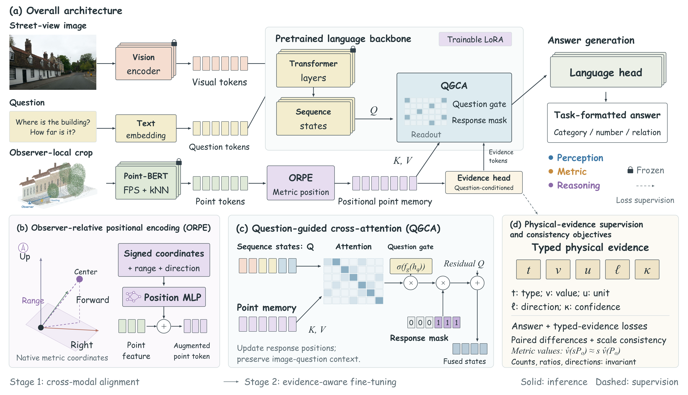

  <h2><strong>UrbanEgo3D: Observer-Centered Urban Spatial Understanding from Street Views and Local Point Clouds</strong></h2>
  <h5>
    <em>Yiping Song, Qingyu Li</em>  
    School of Science and Engineering 
    The Chinese University of Hong Kong, Shenzhen
  </h5>
  

    [<a href="#dataset-overview">📚 Dataset</a>]&nbsp;
    [<a href="#egometric-lmm">🧩 Method</a>]&nbsp;
    [<a href="#results">📊 Results</a>]&nbsp;
    [<a href="#release">📦 Release</a>]
  

  
<strong>13,998 QA pairs &nbsp;·&nbsp; 12 urban regions &nbsp;·&nbsp; 688 observation positions &nbsp;·&nbsp; 13 tasks</strong>

  

Paired street views and local point clouds, with the observer as the spatial reference. The 3D rendering, coordinate glyphs, and example answers are illustrative.

## 🔥 News

- **Coming soon:** The UrbanEgo3D dataset and EgoMetric-LMM code will be made publicly available in this repository.

## 📚 Contents

- [Dataset Overview](#dataset-overview)
- [EgoMetric-LMM](#egometric-lmm)
- [Results](#results)
- [Release](#release)
- [Acknowledgements](#acknowledgements)

## 🔍 Dataset Overview

**UrbanEgo3D** is an observer-centered benchmark for urban spatial understanding. It combines street-view images and local semantic point clouds to answer questions from an observer's position and heading, with answers derived from local geometry.

- **Paired observations.** Street views provide ground-level semantics, while local point clouds provide metric 3D geometry.
- **Observer-centered questions.** Position and heading define a common reference for spatial answers.
- **Geographically disjoint evaluation.** Training, validation, and evaluation use separate urban regions.

The benchmark contains **13,998 question–answer pairs** from **12 urban regions** and **688 real observation positions**, covering **13 tasks** across three families:

| Task family | Capability |
| :--- | :--- |
| 🔵 **Perception** | Identify semantic content relative to the observer. |
| 🟠 **Metric** | Measure physical quantities using local geometry. |
| 🟣 **Reasoning** | Compare regions, combine spatial conditions, and order targets. |

## 🧩 EgoMetric-LMM

**EgoMetric-LMM** combines street-view semantics with observer-relative geometry for urban spatial question answering.

  

Model architecture and training objectives. The local 3D view and attention patterns are schematic.

The method consists of three components:

1. **Observer-relative positional encoding (ORPE)** augments pretrained Point-BERT features with observer-relative metric information.
2. **Question-guided cross-attention (QGCA)** retrieves point evidence relevant to the question for answer generation.
3. **Physical-evidence supervision with consistency objectives** encourages predictions to agree with spatial measurements and controlled geometric changes.

Training follows **two stages**: cross-modal alignment, followed by joint optimization of answer generation and physical-evidence prediction with supervised losses and consistency objectives.

## 📊 Results

On the **1,637-question evaluation split** of UrbanEgo3D, EgoMetric-LMM achieves **56.56% overall macro accuracy**, improving over the strongest evaluated baseline by **11.80 percentage points**.

| Model | Input observations | Overall macro accuracy |
| :--- | :--- | :---: |
| Point-BERT–Qwen3-VL | Street-view image + local point cloud | 44.76% |
| **EgoMetric-LMM** | Street-view image + local point cloud | **56.56%** |

## 📦 Release

**Data and code will be made publicly available here.** This repository currently provides the project overview; datasets, model code, and download links are not yet available.

- [ ] UrbanEgo3D dataset and annotations
- [ ] Training and evaluation code
- [ ] Setup and usage instructions

Download instructions and applicable licensing information will accompany the release.

## 🙏 Acknowledgements

The README layout is adapted from the project presentation of [GeoLLaVA-8K](https://github.com/MiliLab/GeoLLaVA-8K) and [XLRS-Bench](https://github.com/AI9Stars/XLRS-Bench). Project descriptions, figures, and results on this page are specific to UrbanEgo3D and EgoMetric-LMM.
