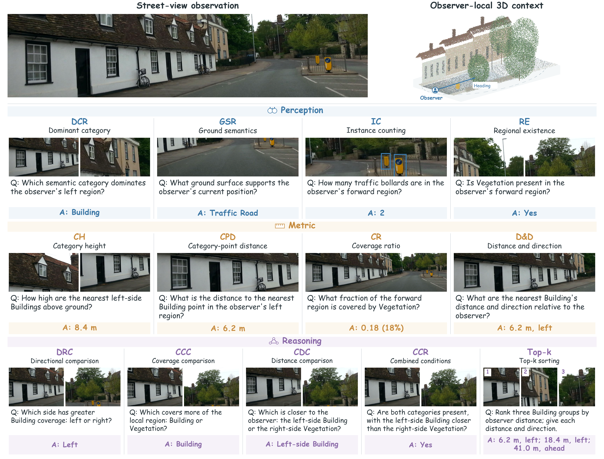
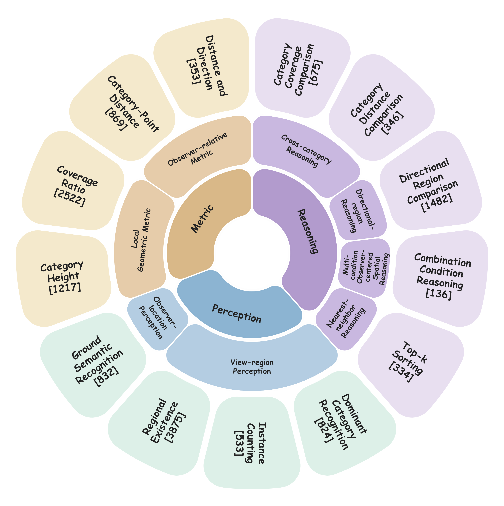

  <h2><strong>UrbanEgo3D: Observer-Centered Urban Spatial Understanding from Street Views and Local Point Clouds</strong></h2>
  <h5>
    <em>Yiping Song1, Qingyu Li2</em>  
    1 Naval University of Engineering 
    2 School of Science and Engineering, 
    The Chinese University of Hong Kong, Shenzhen
  </h5>
  

    [<a href="#dataset-overview">📚 Dataset</a>]&nbsp;
    [<a href="#egometric-lmm">🧩 Method</a>]&nbsp;
    [<a href="#results">📊 Results</a>]&nbsp;
    [<a href="#release">📦 Release</a>]
  

  
<strong>13,998 QA pairs &nbsp;·&nbsp; 12 urban regions &nbsp;·&nbsp; 688 observation positions &nbsp;·&nbsp; 13 tasks</strong>

  

Observer-centered urban spatial questions across Perception, Metric, and Reasoning.

## 🔥 News

- **Coming soon:** The UrbanEgo3D dataset and EgoMetric-LMM code will be made publicly available in this repository.

## 📚 Contents

- [Dataset Overview](#dataset-overview)
- [EgoMetric-LMM](#egometric-lmm)
- [Results](#results)
- [Release](#release)

## 🔍 Dataset Overview

**UrbanEgo3D** is an observer-centered benchmark for urban spatial understanding. It combines real street-view images and local semantic point clouds, with questions and geometrically derived answers defined relative to the observer's position and heading.

The benchmark contains **13,998 question–answer pairs** from **12 geographically disjoint urban regions** and **688 real observation positions**. Its task hierarchy comprises **three capability families**, **eight dimensions**, and **thirteen tasks**.

  

Three-level task hierarchy. Brackets indicate question–answer counts.

| Task family | Capability |
| :--- | :--- |
| 🔵 **Perception** | Identify semantic content at the observer's position and within surrounding regions. |
| 🟠 **Metric** | Measure local geometric properties and observer-relative distances and directions. |
| 🟣 **Reasoning** | Compare categories and regions, combine spatial conditions, and rank targets by proximity. |

**Key features**

- **Paired observations:** Street-view images provide ground-level semantics, while local point clouds provide metric 3D geometry.
- **Observer-relative answers:** Position and heading establish a shared reference for spatial questions and answers.
- **Geometrically derived annotations:** Task-specific programs compute answers from semantic labels and local geometry, supported by automated checks and human review.
- **Geographically disjoint evaluation:** Training, validation, and evaluation use separate urban regions.

## 🧩 EgoMetric-LMM

**EgoMetric-LMM** combines street-view semantics with observer-relative geometry for urban spatial question answering.

  

Model architecture and training objectives. The local 3D view and attention patterns are schematic.

The method consists of three components:

1. **Observer-relative positional encoding (ORPE)** augments pretrained Point-BERT features with observer-relative metric information.
2. **Question-guided cross-attention (QGCA)** retrieves point evidence relevant to the question for answer generation.
3. **Physical-evidence supervision with consistency objectives** encourages predictions to agree with spatial measurements and controlled changes in geometric evidence.

Training follows **two stages**. The first stage aligns point features with the pretrained vision–language model. The second jointly optimizes answer generation and physical-evidence prediction using supervised losses and consistency objectives.

## 📊 Results

We compare image–text, point–text, and joint image–point models on the **1,637-question evaluation split** of UrbanEgo3D.

**Overall macro accuracy** averages performance across all thirteen tasks under their task-specific scoring rules. Scores are percentages; higher is better. All models receive the question, and the table lists their observation inputs.

| Model | Observation inputs | Overall (%) |
| :--- | :--- | ---: |
| Qwen3-VL-4B-Instruct | Street-view image | 36.35 |
| InternVL3.5-4B | Street-view image | 39.35 |
| MiniCPM-V 4.5 | Street-view image | 40.47 |
| LLaVA-OneVision-1.5-8B | Street-view image | 39.78 |
| Ground3D-LMM-4B | Local point cloud | 25.54 |
| LL3DA-OPT-1.3B | Local point cloud | 39.08 |
| PointLLM-7B-v1.2 | Local point cloud | 39.17 |
| Point-BERT–Qwen3-VL | Street-view image + local point cloud | 44.76 |
| **EgoMetric-LMM** | **Street-view image + local point cloud** | **56.56** |

EgoMetric-LMM improves over the strongest evaluated image–text, point–text, and joint-input baselines by **16.09**, **17.39**, and **11.80 percentage points**, respectively.

## 📦 Release

**Data and code will be made publicly available in this repository.** The repository currently provides the project overview; datasets, model code, and download links are not yet available.

- [ ] UrbanEgo3D dataset and annotations
- [ ] Training and evaluation code
- [ ] Setup and usage instructions

Download instructions and applicable licensing information will accompany the release.
